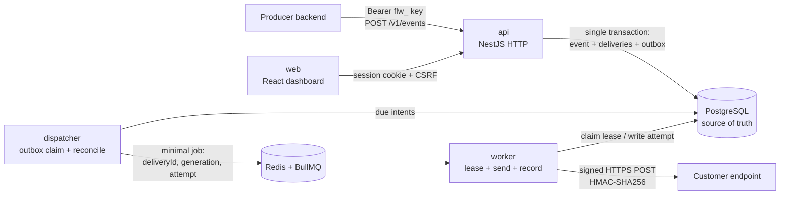

# FlowUp

**Multi-tenant outbound webhook delivery platform.**

> **Publish once. Deliver reliably. Debug easily.**

FlowUp receives business events from authenticated producers, persists them durably, routes them to customer-configured HTTPS endpoints, delivers them asynchronously, retries transient failures within a bounded policy, and exposes full delivery observability with manual replay.

**Version:** 0.1 · **Status:** design complete; implementation specified task by task in [build phase 1](docs/phase-1/)

---

## 1. Context

A SaaS provider that wants to offer outbound webhooks has to build endpoint registration, subscription routing, request signing, retries with backoff, failure tracking, replay, and strict tenant isolation — then operate all of it. FlowUp takes on that responsibility so the provider's team can stay on their core product.

| | |
|---|---|
| **Producer** | an external backend that publishes events with an application-scoped API key |
| **Platform user** | an Admin or Developer who configures applications, endpoints and subscriptions in the dashboard and debugs deliveries |
| **Consumer** | an external HTTPS service that receives signed POSTs — it needs no FlowUp account |

### What FlowUp v0.1 is not

Not a CRM, not marketing automation, not a general workflow builder, not an event transformation engine, not a replacement for ERP or commerce platforms. No billing, AI, connector marketplace or enterprise SSO. Scope is enforced — see [`AGENTS.md`](AGENTS.md).

### Architectural invariants

1. **Durable acceptance** — `202` is returned only after PostgreSQL commits the event, its delivery snapshots and its dispatch intents. Queue availability never affects acceptance.
2. **Correct routing** — one event targets exactly one authorized application; fan-out reaches only matching active subscriptions under it.
3. **Independent delivery** — success, failure and retry are tracked per event × endpoint. HTTP `2xx` is transport acknowledgement, not business completion.
4. **At-least-once, never exactly-once** — a lost acknowledgement after a successful send can duplicate; stable IDs let consumers deduplicate.
5. **Least privilege and safe egress** — every read and write is organization-scoped; delivery validates the URL, the DNS resolution and the actual connection IP.
6. **Traceable execution** — attempts, replay generations, destination snapshots and sanitized failures are persisted.

---

## 2. Architecture

One codebase, four separately runnable processes. PostgreSQL is the source of truth; Redis/BullMQ is execution coordination only.



### Processes

| Process | Responsibility | Never does |
|---|---|---|
| `api` | dashboard and producer HTTP APIs; transactional event acceptance | no synchronous downstream webhook calls |
| `dispatcher` | claims due `outbox_message` rows, enqueues jobs, reconciles work missed during a Redis outage | no HTTP egress; no business decisions |
| `worker` | acquires a DB lease, validates destination safety, signs, sends, records the attempt | never holds a transaction open across network I/O |
| `web` | React SPA dashboard behind an HTTPS reverse proxy | never holds a producer API key |

### Delivery lifecycle

```text
publish ──► ACCEPTED event (immutable) ──► one DELIVERY per matched endpoint
                                             │  (target URL + secret version snapshotted)
                                             ▼
                        outbox intent ──► dispatcher ──► BullMQ job ──► worker lease
                                                                           │
                        ┌──────────────────────────────────────────────────┤
                        ▼                        ▼                         ▼
                   2xx → SUCCEEDED      429/5xx/timeout → RETRY_WAIT   4xx → FAILED
                                                 │                         │
                                       next_attempt_at in DB         manual replay
                                       (bounded backoff + jitter)     generation++ ,
                                                                      attempts preserved
```

Delivery states: `PENDING`, `IN_PROGRESS`, `RETRY_WAIT`, `SUCCEEDED`, `FAILED`, `CANCELLED`. Attempt outcomes: `STARTED`, `SUCCEEDED`, `FAILED`, `UNKNOWN` — `UNKNOWN` when a worker disappears mid-request and the outcome is genuinely unknowable.

**One retry authority:** the database owns the schedule (`delivery.next_attempt_at` plus the next outbox intent) and each BullMQ job performs exactly one attempt (`attempts: 1`). There is deliberately no second queue-level retry loop.

### Durability and recovery

| Failure | Outcome | Recovery |
|---|---|---|
| DB unavailable at publish | no acceptance, `5xx` | producer retries with the same idempotency key |
| DB committed, Redis down | `202` already valid | outbox stays pending; dispatcher retries; reconciler re-enqueues |
| Dispatcher crashes after enqueue | duplicate job possible | deterministic job ID + worker lease and generation check |
| Worker dies before send | lease expires | reclaimed and resent |
| Worker dies after a downstream `2xx` | consumer may receive twice | at-least-once; stable IDs for consumer dedup |
| DNS later resolves to a private IP | send blocked | terminal `unsafe_destination`, no contact made |
| No subscription matches | event accepted with zero deliveries | dashboard explains the reason honestly |

### Security posture

- Tenant scope is derived from the authenticated principal, never from caller input. Non-owned IDs return `404` to avoid cross-tenant existence leaks.
- Producer machine keys and human dashboard sessions are separate authentication modes and are never interchangeable.
- API keys are stored as hashes; endpoint signing secrets are encrypted and versioned. Raw values are shown exactly once, at creation or rotation.
- SSRF defense in depth: HTTPS and globally routable destinations only; loopback, private, link-local, multicast and cloud-metadata ranges blocked for IPv4 and IPv6; the resolved and connected IP is validated, not just the URL string; redirects disabled in v0.1.
- Outbound signature: `HMAC_SHA256(secret, timestamp + '.' + raw_body)` over the exact bytes sent, carried in `FlowUp-Signature: v1=<hex>`.
- Signatures, credentials, raw payloads and downstream response bodies are redacted from logs and errors.

### Stack

| Layer | Technology |
|---|---|
| Backend | TypeScript · NestJS · Prisma · PostgreSQL · BullMQ · Redis |
| Frontend | React · TypeScript · TanStack Router · TanStack Query · Axios · shadcn/ui · Tailwind CSS |
| Tooling | Bun workspaces · Docker Compose · environment-based configuration |

Runtime note: Bun is the package manager and workspace tool. Using Bun as the *runtime* for the NestJS processes is gated on the **ADR-06** compatibility matrix in [`BE-01`](docs/phase-1/BE-01.md); the documented fallback is Bun + Node.js LTS with no architectural change.

---

## 3. Repository layout

```text
apps/
  api/          NestJS HTTP app (dashboard + producer APIs)
  dispatcher/   outbox claim and BullMQ enqueue
  worker/       delivery execution
  web/          React dashboard
packages/
  contracts/    Zod types + OpenAPI-derived client types (the only shared contract source)
  config/       env schema, logging and telemetry config
prisma/         single centralized schema and migrations
infrastructure/ docker-compose.yml, raw SQL migrations
docs/           product, design, planning and setup documents
```

---

## 4. Documentation

Approved documents are the source of truth, in this priority order:

| # | Document | Contains |
|---|---|---|
| 1 | [`PRODUCT_OVERVIEW.md`](docs/PRODUCT_OVERVIEW.md) | product identity and scope boundary |
| 2 | [`URD.md`](docs/URD.md) | user and business requirements (`UR-*`) |
| 3 | [`PRD.md`](docs/PRD.md) | functional behavior (`FR-*`, `NFR-*`, `AT-*`) |
| 4 | [`SYSTEM_ARCHITECTURE.md`](docs/SYSTEM_ARCHITECTURE.md) | boundaries, invariants, failure analysis, `ADR-*` |
| 5 | [`DATABASE_DESIGN.md`](docs/DATABASE_DESIGN.md) | tables, constraints, state machines, transactions |
| 6 | [`API_SPECIFICATION.md`](docs/API_SPECIFICATION.md) | `/v1` contract, error envelope, signing headers |
| 7 | [`TECHNICAL_DESIGN.md`](docs/TECHNICAL_DESIGN.md) | module layout, publish path, dispatcher, worker, egress |
| 8 | [`UI_UX_SPECIFICATION.md`](docs/UI_UX_SPECIFICATION.md) | screens (`UI-*`) and UX acceptance (`UX-AC-*`) |
| 9 | [`IMPLEMENTATION_PLAN.md`](docs/IMPLEMENTATION_PLAN.md) | milestones, `BE-*`/`FE-*` tasks, open ADRs |
| 10 | [`TEST_PLAN.md`](docs/TEST_PLAN.md) | verification requirements (`QA-*`) |

If two documents conflict, the conflict is reported and resolved — never chosen silently.

---

## 5. Getting started

Implementation is specified task by task in build phase 1, which covers the whole v0.1 pilot:

[`docs/phase-1/`](docs/phase-1/) holds one specification file per implementation task, plus an index with the shared conventions, the open-ADR map and the phase exit criteria.

| Document | Covers |
|---|---|
| [`docs/phase-1/README.md`](docs/phase-1/README.md) | spec index, cross-task rules, environment contract, ADR gates, exit criteria |
| [`BE-01`](docs/phase-1/BE-01.md) → [`BE-14`](docs/phase-1/BE-14.md) | workspace and infrastructure, auth and RBAC, schema, applications, API keys, endpoints, publish, outbox dispatcher, worker, retry and recovery, read APIs, replay, hardening, published contract |
| [`FE-01`](docs/phase-1/FE-01.md) → [`FE-10`](docs/phase-1/FE-10.md) | shell and API client, session guard, applications, endpoints and secrets, API keys, events, deliveries, replay, usage and accessibility, browser E2E |

Start with `BE-01` and `FE-01`; the index's milestone map gives the dependency order after that.

`BE-01` and `FE-01` deliberately implement no authentication, no business endpoint and no business table: **ADR-01** (dashboard session/invitation/CSRF contract) must be resolved before `BE-02` or `FE-02` starts. Each specification names the ADR that blocks it.

---

## 6. Working with AI coding agents

This repository is agent-ready and keeps **one** canonical rule set:

| File | Purpose |
|---|---|
| [`AGENTS.md`](AGENTS.md) | repository rules — authoritative |
| [`AGENT_ADAPTER.md`](AGENT_ADAPTER.md) | tool-agnostic adapter: rule loading, document resolution, the universal task loop, required report format, non-negotiable invariants |
| [`apps/api/AGENTS.md`](apps/api/AGENTS.md) | backend rules |
| [`apps/web/AGENTS.md`](apps/web/AGENTS.md) | frontend rules |

Tool-specific files (`CLAUDE.md`, `.cursor/rules/flowup.mdc`, `.github/copilot-instructions.md`, `GEMINI.md`, `.windsurfrules`) are pointers, not copies. Any agent not listed there reads `AGENTS.md` and `AGENT_ADAPTER.md` directly.

Every change traces to a requirement ID, every schema change ships with a migration, and no verification is reported unless it was actually executed.
