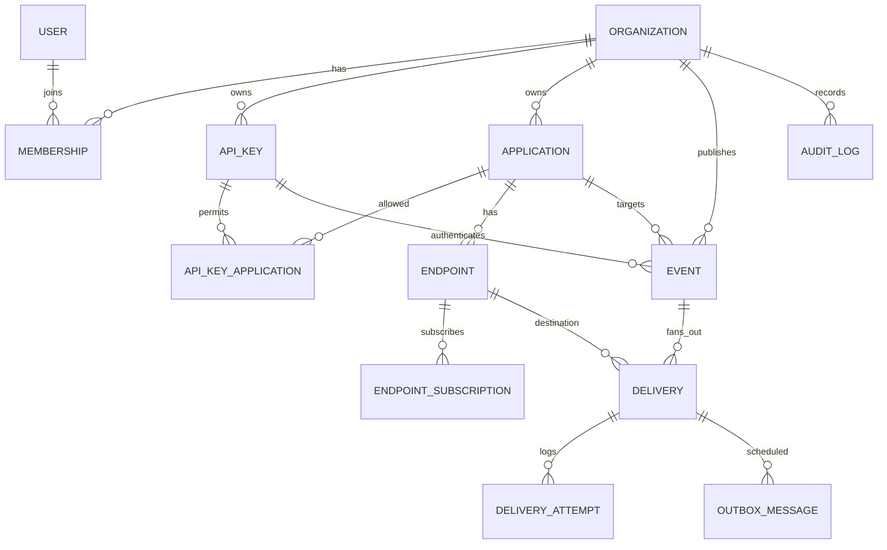

# FlowUp — Database Design v0.1

**Status:** Draft, derived from URD/PRD and `SYSTEM_ARCHITECTURE.md`  
**Database:** PostgreSQL | **ORM:** Prisma (with SQL migrations for partial indexes/locking where needed)

## 1. Principles

- Every business row belongs to an `organization_id` directly or through a tenant-owned parent; API queries enforce tenant ownership.
- Events and attempts are append-oriented. No editing original accepted event payload or historical delivery attempt.
- A delivery is one `(event_id, endpoint_id)` obligation. Replay increments **generation** on that delivery and appends attempts.
- BullMQ is execution coordination; Postgres records **authoritative delivery state, due times, attempts, and dispatch intents**.
- Store bounded payload; encrypt signing secrets. Never put plaintext API keys or endpoint secrets in event/attempt logs.

## 2. ERD

## 3. Core tables

Types: UUID primary keys unless otherwise noted; UTC `timestamptz`; common `created_at`, `updated_at` where applicable. Unique/index constraints below are part of requirements, not optional optimizations.

### Identity and scope

| Table | Important columns | Constraints / usage |
|---|---|---|
| `organization` | `id`, `name`, `status`, timestamps | tenant root |
| `user` | `id`, `email_normalized`, `password_hash` or external auth identity, timestamps | unique normalized email; never store plaintext password |
| `membership` | `organization_id`, `user_id`, `role` (`ADMIN`, `DEVELOPER`), timestamps | unique `(organization_id,user_id)` |
| `application` | `id`, `organization_id`, `name`, `status` (`ACTIVE`,`DISABLED`) | unique `(organization_id,id)`; app is recipient boundary |
| `api_key` | `id`, `organization_id`, `name`, `key_prefix`, `secret_hash`, `status`, `last_used_at`, `revoked_at` | unique key prefix or safe lookup token; secure hash; raw key shown once |
| `api_key_application` | `api_key_id`, `application_id`, `organization_id` | unique `(api_key_id,application_id)`; composite foreign keys prevent cross-org assignment |

### Destination and subscriptions

| Table | Important columns | Constraints / usage |
|---|---|---|
| `endpoint` | `id`, `organization_id`, `application_id`, `name`, `url`, `status`, `signing_secret_ciphertext`, `signing_key_version`, timestamps | unique `(organization_id,id)`; URL validated at save and send |
| `endpoint_subscription` | `id`, `endpoint_id`, `organization_id`, `event_type`, timestamps | unique `(endpoint_id,event_type)`; bounded normalized type |

For rotation, use optional `endpoint_secret_version(id,endpoint_id,version,ciphertext,created_at,expires_at)` rather than overwriting a secret still referenced by pending deliveries. Snapshot the `secret_version_id` on delivery. Pending delivery after secret rotation must still use securely retained key version, until retry horizon expires. A phase-1 simpler **immediate rotation** is acceptable only if remaining pending sends are intentionally migrated or cancelled with documented behavior.

### Events and execution

| Table | Important columns | Constraints / usage |
|---|---|---|
| `event` | `id`, `organization_id`, `application_id`, `api_key_id`, `type`, `data_json`, `payload_hash`, `idempotency_key`, `request_fingerprint`, `status=ACCEPTED`, `accepted_at`, `retention_until`, `delivery_count`, `no_matching_reason` | unique `(organization_id,api_key_id,idempotency_key)`; event immutable after accept |
| `delivery` | `id`, `organization_id`, `event_id`, `endpoint_id`, `target_url_snapshot`, `secret_version_id`, `status`, `generation`, `attempts_in_generation`, `next_attempt_at`, `lease_owner`, `lease_expires_at`, `last_error_code`, timestamps | unique `(event_id,endpoint_id)`; state authoritative |
| `delivery_attempt` | `id`, `organization_id`, `delivery_id`, `generation`, `attempt_number`, `started_at`, `finished_at`, `duration_ms`, `http_status`, `result`, `error_code`, `worker_id` | unique `(delivery_id,generation,attempt_number)`; immutable after finalization, no raw remote response body |
| `outbox_message` | `id`, `organization_id`, `delivery_id`, `generation`, `kind`, `state`, `available_at`, `lease_until`, `enqueue_attempts`, `enqueued_at`, timestamps | unique `(delivery_id,generation,kind)` for active dispatch intent; state/claim for outbox dispatcher |
| `audit_log` | `id`, `organization_id`, `actor_type`, `actor_id`, `action`, `resource_type`, `resource_id`, `safe_metadata_json`, `created_at` | append-only; no secrets/payloads |

**Outbox retry nuance:** One delivery generation can have several delayed automatic attempts. Model `outbox_message` as a scheduled **per-attempt enqueue intent** with `attempt_number` included in unique `(delivery_id,generation,attempt_number,kind)` OR create a new outbox row each time an attempt schedules another. Do **not** use only `(delivery_id,generation)` for all retry intents. Adopt `attempt_number` in actual schema below.

### Canonical `outbox_message` columns (normative)

`id`, `organization_id`, `delivery_id`, `generation`, `attempt_number`, `kind='DELIVER'`, `state` (`PENDING`,`CLAIMED`,`ENQUEUED`), `available_at`, `lease_until`, `claim_token`, `enqueue_attempts`, `enqueued_at`, `created_at`.

Unique `(delivery_id,generation,attempt_number,kind)`. BullMQ job ID derived deterministically from `deliveryId:generation:attemptNumber`, with characters normalized for BullMQ compatibility. Reconciler checks DB due state as source of truth and can recreate missing queue work after Redis loss.

## 4. State machines

| Domain | Allowed states | Legal movements |
|---|---|---|
| Application | ACTIVE, DISABLED | ACTIVE ↔ DISABLED |
| Endpoint | ENABLED, DISABLED | ENABLED ↔ DISABLED |
| API key | ACTIVE, REVOKED | ACTIVE → REVOKED |
| Event | ACCEPTED | immutable accepted event |
| Delivery | PENDING, IN_PROGRESS, RETRY_WAIT, SUCCEEDED, FAILED, CANCELLED | PENDING → IN_PROGRESS/CANCELLED; IN_PROGRESS → SUCCEEDED/RETRY_WAIT/FAILED; RETRY_WAIT → IN_PROGRESS/CANCELLED; FAILED → PENDING only via authorized replay and generation++ |
| Attempt | STARTED, SUCCEEDED, FAILED, UNKNOWN | STARTED → terminal; UNKNOWN when lease expires and outcome uncertain |

Capture an attempt as `UNKNOWN` if worker disappears mid-HTTP and lease recovery determines that the attempt outcome is unknowable. Next attempt may duplicate consumer processing.

## 5. Transactions and concurrency

### Publish (`AT-01`, `AT-02`, `AT-03`, `AT-10`)

Within one transaction: validate ownership + eligible subscriptions with agreed isolation semantics; insert Event idempotency record; insert Delivery per matched endpoint (including snapshot URL and secret version); insert first OutboxMessage per Delivery. Commit, then `202`.

Use DB unique idempotency index to arbitrate concurrency. If insert collides, query existing accepted event, compare request fingerprint and return existing response or `409`. Do not hold DB transactions while calling Redis or external HTTP.

### Worker claim (`AT-04`, `AT-11`)

Use atomic `UPDATE ... WHERE status IN ('PENDING','RETRY_WAIT') AND (lease_expires_at IS NULL OR lease_expires_at < now()) AND generation = $job_generation AND next_attempt_at <= now() RETURNING ...`; ensure only one worker has a live lease. An already `SUCCEEDED`, `FAILED`, `CANCELLED`, disabled or stale generation job becomes no-op. Worker records attempt STARTED, performs HTTP outside the claim transaction, and conditionally finalizes based on owner/lease token. Recovery marks stale STARTED as UNKNOWN, reclaims due delivery and writes next outbox intent.

### Retry scheduling (`AT-04`, `AT-05`)

Within DB transaction after attempt result: append/complete attempt, update delivery `RETRY_WAIT`, next due, increment per-generation attempt count, insert next OutboxMessage. Dispatcher does the Redis enqueue outside this transaction. Enforce `attempts_in_generation < max_attempts` and retry horizon.

### Replay (`AT-07`)

Lock delivery row; require status `FAILED` and endpoint `ENABLED`. Increment generation, reset per-generation count, insert outbox intent for attempt 1, append actor audit log; do not erase old attempts. Replay request idempotency token / actor operation ID guards double click.

## 6. Indexes and retention

- `event (organization_id, accepted_at DESC)`, `(organization_id, application_id, accepted_at DESC)`, `(organization_id, type, accepted_at DESC)`.
- `delivery (organization_id,status,next_attempt_at)`, `(organization_id,endpoint_id,created_at DESC)`, `(event_id,endpoint_id)` unique.
- `delivery_attempt (delivery_id,generation,attempt_number)`, `(organization_id,started_at DESC)`.
- `outbox_message (state,available_at)` filtered to PENDING; `(state,lease_until)` for reclaim. PostgreSQL partial indexes may require raw SQL migration in Prisma.
- `endpoint_subscription (endpoint_id,event_type)` unique; indexes on tenant/app and key permissions.
- First release: operations retention baseline **30 days proposal**. Define separate policy for audit and idempotency tombstones; never allow old key reuse accidentally during documented idempotency window. Deletion jobs must not remove event payload while retry/replay eligibility remains.

## 7. Data integrity / security

- Multi-tenant composite constraints where possible; service always passes tenant ID to repository methods. Consider Postgres RLS as defense in depth after base app authorization is well-tested.
- Encrypt destination signing secrets with managed encryption key or an app-level authenticated encryption envelope; rotate master key, keep version metadata. Key hash must be resistant to offline guessing given high-entropy random API keys.
- Payload may contain PII: minimize extraction, encrypt DB backups, redact logs, set retention, restrict employee access.
- Avoid cascading delete of accepted events/deliveries while within retention; archive/delete using explicit lifecycle policy.

## 8. Migration sequence

1. Organization/User/Membership and Application.
2. API Key + permission association.
3. Endpoint + subscription + signing secret version.
4. Event, Delivery, Attempt, Outbox, Audit and constraints.
5. Indexes, partial indexes and cleanup jobs.

## 9. Requirement traceability and design review

- `FR-EVT-*`: Event + idempotency unique index + transaction.
- `FR-APP-*`, `FR-END-*`: Application/Endpoint/Subscription and scope FK.
- `FR-DEL-*`, `FR-RET-*`: Delivery/Attempt/Outbox, leases, retry status.
- `FR-REP-*`: generation and audit, guarded mutation.
- `FR-OBS-*`, `FR-SEC-*`: query indexes, data retention and tenant ownership.

Before coding, finalize Prisma schema naming, secret-version migration behavior, attempt lease recovery policy, retention of idempotency keys and any use of RLS. See API and Technical Design.
