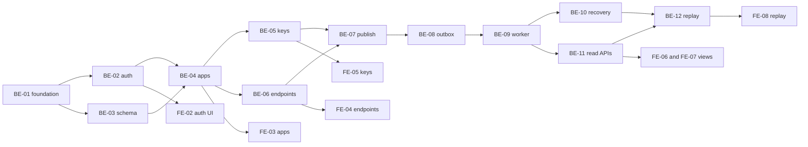

# FlowUp — Implementation Plan v0.1

**Status:** Engineering planning draft | **Phase:** 3 | **Dependencies:** Phase 1 (Overview, URD, PRD), Phase 2 (Architecture, Database, API, Technical), `UI_UX_SPECIFICATION.md`.
**Goal:** one pilot organization can onboard, configure two endpoints, publish one event, inspect independent outcomes and replay a final failed delivery securely.

## 1. Delivery approach

- Monorepo with Bun workspaces; `apps/api` (NestJS, Prisma, PostgreSQL), `apps/web` (React, TanStack Router/Query, Axios, shadcn/ui), shared Zod/types where useful; processes `api`, `dispatcher`, `worker` from same backend codebase.
- Infrastructure: Docker Compose PostgreSQL, Redis (`noeviction`), NestJS API + dispatcher + worker, React static deployment. Prisma migrations reviewed and versioned.
- DB is authoritative; transactional publish creates event/deliveries/outbox. BullMQ is transport/scheduling; jobs carry identifiers rather than sensitive payloads. End-to-end at-least-once, bounded retry, verified safe public HTTPS destinations.
- **No feature creep:** no CRM, automated marketing, workflow builder, billing, customer portal, AI, connectors or enterprise SSO.
- Each task PR must include code, tests, migration/contract changes, observability and updated docs when applicable.

## 2. Milestones and exit gates (dependency-ordered)

| Milestone | Primary deliverable | Gate to proceed |
|---|---|---|
| M0 — Contracts & setup | Auth/session ADR, secret rotation policy, repo/CI, OpenAPI skeleton | Security-sensitive Phase 2 open questions resolved |
| M1 — Ingest & durable routing | Schema, producer auth, apps/endpoints, event acceptance, outbox | Same-key duplicate safe, no subscribers handled, Redis down does not lose accepted event |
| M2 — Reliable delivery | Dispatcher, BullMQ workers, HMAC, SSRF, retry, crash recovery | Failure injection and independent endpoint delivery pass |
| M3 — Management UI | Invite/login, organization RBAC, applications, endpoints, keys, lists/details | Self-service pilot workflow in browser; secrets shown once |
| M4 — Incident recovery | Replay, audited history, status dashboard, pagination | Replay/idempotency/race tests pass; history preserved |
| M5 — Pilot hardening | Security, performance, retention, operational monitoring and runbook | QA release gate green; no open severity-1/2 defects |

Parallel FE work may start with mocks after OpenAPI fixtures stabilize; M0 and core auth cannot be skipped before external pilot.

## 3. Backend implementation tasks

| ID | Scope and deliverables | Dependencies | Acceptance / tests | Requirements |
|---|---|---|---|---|
| BE-01 | Bootstrap Bun workspace, NestJS config, logging/request IDs, Prisma, Postgres/Redis Compose, CI | None | App health in Compose; tests/migrations run via CI | NFR-07 |
| BE-02 | Define human auth invitation/session/CSRF OpenAPI addendum and implement secure organization/RBAC | BE-01, decision ADR-01 | 401/403/404 isolation tests; Admin vs Developer enforced | FR-ORG-*, FR-SEC-01 |
| BE-03 | Prisma schema, constraints, indexes, secrets versions, attempts, outbox and audit; migration fixtures | BE-01 | SQL uniqueness/race tests; fixtures deterministic | FR-EVT-03/05, FR-DEL-01, FR-OBS-* |
| BE-04 | Organization-scoped applications CRUD incl disable with explicit pending policy | BE-02, BE-03 | Cross-tenant ID rejected; disabled app blocks publish | FR-APP-* |
| BE-05 | API key creation/verify/revoke, hash and app allowlist, redacted metadata | BE-02, BE-03, BE-04 | Raw key shown only once, revoked/out-of-scope rejected | FR-KEY-*, FR-SEC-04 |
| BE-06 | Endpoints CRUD, subscriptions, URL validation, encrypted/versioned secret, disable/rotation policy | BE-02, BE-03, BE-04 | Disable cancel pending; future URL updates not retroactive; SSRF rejected | FR-END-*, FR-SEC-02 |
| BE-07 | Event publish API with body/type/key-scope validation, DB transaction, delivery snapshots, idempotency fingerprint | BE-03–06 | `202` durable, duplicate same-key stable, conflict `409`, no subscribers `202`/0 | FR-EVT-*, FR-DEL-01 |
| BE-08 | DB outbox dispatcher + BullMQ enqueue, retry enqueue on outage, queue reconciliation | BE-03, BE-07 | Redis outage and restart results in eventual enqueue; no duplicate business delivery | FR-RET-04, NFR-01 |
| BE-09 | Worker atomic lease, safe HTTP egress, HMAC canonical signing, target snapshot, attempt writes | BE-06, BE-08 | 2xx success, 429/5xx retries, 4xx terminal, DNS/redirect blocked, signature verifier passes | FR-DEL-*, FR-RET-* |
| BE-10 | Bounded retry with persisted next due, lease expiry recovery, UNKNOWN attempts, generation guards | BE-09 | Crash-after-send may duplicate but history coherent; exhausted final FAIL | FR-RET-*, NFR-03/04 |
| BE-11 | Event/delivery/attempt read APIs with cursor/filter, usage summary, redaction | BE-03, BE-07, BE-09 | Scope checks and stable cursor; no secret leaks | FR-OBS-* |
| BE-12 | Replay transaction + operation idempotency + audit + generation-aware queue | BE-10, BE-11 | Only final FAILED, concurrent replay returns prior result/409 | FR-REP-* |
| BE-13 | Rate limits, retention/redaction jobs, metrics/health, deployment config and secure operations runbook | BE-05, BE-09–12 | Security, cleanup and pilot metrics test evidence | FR-SEC-03/05/06, NFR-* |
| BE-14 | Publish OpenAPI, sample producer cURL and raw-byte consumer HMAC verifier; CI contract generation | BE-02, BE-07, BE-09, BE-12 | Independent verifier matches header; generated types compile | NFR-06, API v0.1 |

## 4. Frontend implementation tasks

| ID | Scope and deliverables | Dependencies | Acceptance / tests | Requirements |
|---|---|---|---|---|
| FE-01 | React/Vite/Bun app, TanStack Router/Query, Axios wrapper, shadcn shell, error/error-boundary and typed API client | M0 API fixtures, BE-01 | Testable navigation, mock API states, no producer key in browser | UI-10 |
| FE-02 | Login/session guard, role-aware navigation, invite-required/access-denied views | BE-02, FE-01 | Session expiration and deep-link 403 handled; developer cannot see Admin screens | UI-01, FR-ORG-* |
| FE-03 | Applications list/create/edit/disable + recipient ID copy + integration instructions | BE-04, FE-01/02 | No unauthorized cross-app operations; forms validated | UI-03, FR-APP-* |
| FE-04 | Endpoints list/form/detail, subscription editing, disable, signing secret rotation one-time dialog | BE-06, FE-03 | Unsafe URL server error, future-only URL notice, secret never redisplayed | UI-04/05, FR-END-* |
| FE-05 | Admin API keys create/revoke, scope picker, one-time key dialog | BE-05, FE-02/03 | Raw key only immediately after creation; no query caching of secret | UI-06, FR-KEY-* |
| FE-06 | Events list/detail, filters, cursor pagination, accepted/zero-subscriber states | BE-11, FE-03 | No fake delivery if recipient absent; correct states | UI-07, FR-OBS-01 |
| FE-07 | Deliveries list/detail, attempt timeline, status/next-retry/errors | BE-11, FE-04/06 | Endpoint A/B independent, UNKNOWN attempts not mislabeled | UI-08/09, FR-OBS-02/04 |
| FE-08 | Replay confirmation, idempotency header per user action, status/race UX | BE-12, FE-07 | `202` updates generation; `409` prompts refresh; no duplicate click | UI-09, FR-REP-* |
| FE-09 | Usage dashboard, responsive/accessibility pass, empty/error/loading states, test IDs | BE-11, FE-01/06/07 | Screenshot/keyboard/mobile smoke and retry behavior pass | UI-02/10 |
| FE-10 | Browser E2E tests + documentation examples + secret safety hardening | FE-02–09, BE-14 | Pilot path verified in real services; no secret leaks | UX-AC-01..10 |

## 5. Task dependency graph

## 6. Definition of Done (every task)

1. Implementation matches normative API contract or updates the contract through review first; IDs trace to UR/FR/UI/test cases.
2. Success, failure, permission, empty and replay/idempotency edge tests included where applicable.
3. No secrets, credentials, response bodies, or raw PII leaked via logs, browser storage, queue jobs, error bodies or analytics.
4. Database migrations reversible/forward-safe where practical, with upgrade/backfill note.
5. Health/structured logs/metrics instrumented for new work; no async work silently dropped.
6. Code review, typecheck, lint, unit/integration tests and applicable E2E pass.

## 7. Pilot acceptance scenario

1. Operator invites organization admin; admin signs in, creates recipient application and publisher API key scoped to it.
2. Admin/developer configures **two** public HTTPS endpoints that subscribe `order.created`; copies signing secrets once.
3. Producer sends signed-in-scope event `POST /v1/events` with idempotency header; receives stable `202` ID.
4. Endpoint A returns 2xx; endpoint B returns 503 then 2xx. Delivery histories independent; each attempt visible.
5. Producer retries same idempotency key; event count unchanged; conflicting content returns `409`.
6. B permanently fails in a second test; authorized user replays after restoration and sees new generation/history.
7. A disabled endpoint receives no new attempts; cross-organization data is inaccessible; private IP target rejected.
8. Stop Redis during publish and stop worker after a send; system recovers safely after restart without losing accepted events, while acknowledging possible duplicated consumer receipt.

## 8. Risks, open decisions and go/no-go

| Issue | Must resolve before | Owner |
|---|---|---|
| ADR-01 dashboard auth/session/invitation + CSRF contract | FE-02 / pilot | Backend + security |
| ADR-02 immediate versus overlap signing-key rotation, pending secret version | BE-06 / pilot | Backend |
| ADR-03 app disable effect on pending deliveries | BE-04 / pilot | Product + backend |
| ADR-04 retry schedule, max age/attempts, timeout, payload cap, retention, tenant quotas | BE-09/13 | Product + backend |
| ADR-05 exact outbound header/body version + published OpenAPI | BE-14 / external integration | Backend |
| ADR-06 Bun/NestJS/Prisma/BullMQ runtime compatibility matrix | M0 | Backend |

Pilot **no-go** if tenant isolation, SSRF, signing, durable acceptance, duplicate-safe idempotency, replay auditability or recovery tests are failing. No paid launch claim until pricing, support and actual pilot user demand are validated.
