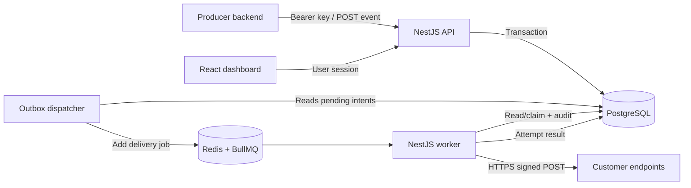

# FlowUp — System Architecture v0.1

**Status:** Draft for engineering review  
**Inputs:** `PRODUCT_OVERVIEW.md`, `URD.md`, `PRD.md`  
**Stack decision:** NestJS/TypeScript, Bun workspace, Prisma/PostgreSQL, Redis/BullMQ, React/TanStack/Axios/shadcn  
**Boundary:** Outbound webhook delivery only. No inbound third-party connectors, CRM, generic workflow builder, billing, or AI.

## 1. Goals and architectural invariants

1. **Durable acknowledgement:** `202` only after a PostgreSQL transaction commits immutable Event, matched Deliveries, and durable dispatch intent. Queue availability cannot affect already-accepted events. (`FR-EVT-03/04/08`, `NFR-01`)
2. **Correct routing:** One event targets exactly one authorized `application_id`; fan-out occurs only to matching active subscriptions under that application. (`FR-APP-03`, `FR-END-05`, `FR-DEL-01`)
3. **Independent delivery:** Success/failure/retry are tracked per event × endpoint. HTTP 2xx means transport acknowledgement only. (`FR-DEL-05/06`)
4. **At least once, not exactly once:** Lost acknowledgement after successful HTTP send can produce a duplicate. Stable event/delivery identifiers let consumers deduplicate. (`NFR-03`)
5. **Least privilege + safe egress:** All reads/writes scope by organization and application; delivery checks URL, DNS resolution and actual connection IP. (`FR-SEC-01/02`)
6. **Traceable execution:** Persist attempts, replay generations, selected destination URL snapshots and sanitized failures. (`FR-OBS-*`, `FR-REP-*`)

## 2. Context and actors

- **Platform user:** Admin/Developer manages an organization's keys, applications, endpoints, subscriptions and deliveries through React Dashboard.
- **Producer:** External backend publishes events using an application-scoped API key.
- **Consumer:** External HTTPS service receives signed HTTP POSTs; does not need a FlowUp account.
- **FlowUp operator:** Maintains database, worker, queue, secret encryption key and recovery routines; cannot bypass tenant boundaries through ordinary APIs.

## 3. Deployment — one codebase, separated responsibilities

- **`api` process:** NestJS HTTP controllers for dashboard and producer APIs. Never performs downstream webhook HTTP calls synchronously in publish request.
- **`dispatcher` process:** Reads durable `OutboxMessage` records and enqueues delivery identifiers to BullMQ. Retriable independently when Redis is down.
- **`worker` process:** Consumes BullMQ jobs, acquires a DB lease on the relevant delivery, validates state/safety, sends signed request and stores attempt result.
- **`web` process:** Static React SPA served behind HTTPS reverse proxy.
- **PostgreSQL:** Durable business source of truth, including event payload, endpoint configuration, attempts, audit and outbox.
- **Redis:** Ephemeral work coordination only; not business source of truth. Persistence recommended; use `maxmemory-policy noeviction`.
- **Reverse proxy/network:** Public TLS ingress to API/web. Egress guard in worker plus network-level block of cloud metadata/private address ranges. Store secrets in deployment secret manager or encrypted configuration.

Initial topology: Docker Compose with distinct `api`, `dispatcher`, `worker`, `web`, `postgres`, `redis` containers. **Production pilot:** use managed DB/Redis when feasible, backups and TLS. A single VM is an availability risk, not HA.

## 4. End-to-end flow

### 4.1 Onboarding/configuration

1. Invited/admin user signs in and belongs to one organization.
2. Admin creates logical `Application` representing one recipient boundary.
3. Admin creates API key scoped to explicitly allowed applications; raw key displayed once.
4. Admin/developer creates enabled HTTPS endpoint under an application, chooses event types, and provisions secret.
5. URL validated on create/update; **same checks repeat immediately before connection**.

### 4.2 Event publish — synchronous boundary

1. Authenticate hashed API key and its organization; reject revoked credentials.
2. Validate `Idempotency-Key`, `application_id`, type, JSON data, size and rate limit; check key allows target application.
3. Resolve eligible endpoints from **that application only**; snapshot URL and signing key version in each delivery.
4. In a **single DB transaction**, create accepted Event, idempotency fingerprint record, zero or more Deliveries, and dispatch intents (`OutboxMessage`) for each Delivery.
5. Return `202` with event ID, `delivery_count` and reason `no_matching_subscriptions` when zero.
6. Concurrent idempotent publishes arbitrate via unique index; equal fingerprint returns same event, conflict returns `409`.

`Idempotency-Key` scope = `(organization_id, api_key_id, key)`. Publication fingerprint = SHA-256 of canonical normalized request values; document canonical JSON method in technical design. Retention and idempotency key expiry must be coupled; do not discard keys before the advertised retry horizon.

### 4.3 Dispatch and delivery

1. Dispatcher selects un-enqueued, due outbox messages using a DB claim/lease; enqueues job with `deliveryId` plus execution generation (no payload/secret).
2. Worker obtains delivery lease atomically, checks tenant/app/endpoint status, generation, retry budget and destination snapshot. Disabled endpoint cancels unsent delivery; in-flight request may complete.
3. Revalidate destination at connect time (IP pinning to public resolved address, TLS hostname verification, redirects disabled).
4. Build stable JSON envelope; HMAC-SHA256 signs `timestamp + '.' + exact_raw_body` using endpoint secret version. Attach event/delivery/timestamp/signature headers.
5. Insert attempt record, send within timeout, record duration/status/error code and update delivery with success, retry wait or final failure.
6. Retryable: timeout/transient network, HTTP 429 or 5xx. Other 4xx terminal by default. Queue retry mechanism is **not** the only record of business retry policy; DB owns due time and state.
7. Reconciler periodically discovers `PENDING`/`RETRY_WAIT` due deliveries without active queue work, expired execution leases and outbox not acknowledged, then re-enqueues safely.

### 4.4 Replay

Manual replay allowed only on `FAILED` delivery with enabled endpoint. Concurrency guard locks delivery row, increments `generation`, resets delivery's active execution state while **preserving prior attempts**. A dedicated replay audit entry records actor. Reuses same original event/delivery ID for consumer deduplication; adds generation header for diagnosis. Explicitly warn replay may cause business reprocessing.

## 5. Failure analysis and recovery

| Failure | Result | Recovery |
|---|---|---|
| DB unavailable during publish | No acceptance; return 5xx | Producer retries with same idempotency key |
| DB committed, Redis down | Event/deliveries exist; `202` already valid | Outbox remains pending; dispatcher retries |
| Dispatcher enqueue succeeds, process crashes before DB ack | Duplicate queue insertion possible | BullMQ job id + DB worker claim/generation; reconciler |
| Worker dies before send | Lease expires | Reclaim and resend |
| Worker dies after remote 2xx before DB commit | Downstream may receive twice | At-least-once semantics; stable IDs and consumer dedup |
| Endpoint returns 503/429 | RetryWait + next schedule | bounded backoff/jitter |
| Endpoint returns 400 | Terminal Failed | explicit replay after fix |
| Endpoint disabled | Cancel future unsent delivery | no new attempt; in-flight may finish |
| DNS later resolves to private IP | Send blocked | terminal `unsafe_destination`; no contact |
| No subscription | Event accepted with zero deliveries | UI explains reason |

## 6. Security and privacy

- Separate human session auth from machine publishing API-key auth. RBAC: Admin and Developer (per PRD); Admin manages keys/membership, Developer manages integrations/replay.
- Every query scoped by `organization_id`. Never resolve resources by opaque ID without tenant check. Scoped API keys authorize application IDs.
- Raw API key displayed once; store key prefix and salted/verifiable cryptographic hash. Endpoint signing secrets encrypted at rest, versioned for rotation, never returned in read/list API.
- SSRF defense in depth: only HTTPS, public globally routable IPs, deny private/reserved/loopback/link-local/multicast/metadata, reject redirects, enforce DNS/IP connect verification, outbound firewall, bounded response size, no proxy-from-environment surprises.
- Redact authentication, signatures, raw payloads and arbitrary remote response bodies from logs. Authz required to view event payload. At-rest backup encryption and access review.
- Audit mutations to keys, applications/endpoints, memberships and replay.

## 7. Operational telemetry

- Structured logs with `organization_id`, `event_id`, `delivery_id`, `attempt_id`, `generation`, `worker_id`, sanitized error category, trace ID.
- Metrics: accepted events, active/failed/succeeded deliveries, queue backlog and oldest age, dispatcher lag, delivery p50/p95 latency, retry count, endpoint error category, worker lease expiries.
- Alerts: outbox age > pilot threshold, queue cannot enqueue, reconciler failures, repeated unsafe destinations, DB/Redis capacity, spikes in final failures.
- Start with measurement rather than promised SLOs (`NFR-10`). Retention proposal: 30 days event payload/attempt details; decide audit metadata retention separately.

## 8. Capacity and evolution

Default pilot values **proposals**: JSON data ≤256 KiB, request timeout 10s, five total automatic attempts, backoff base 5s with jitter, retry horizon 24h, 30-day operational retention. Limits to confirm in load/security tests.

Scale workers horizontally with concurrency and per-organization fairness/rate limiting when proven necessary. Do not add Kafka, microservices, SDK ecosystem, billing or high-throughput partitioning to v0.1. Redis memory and DB index growth are practical bottlenecks to benchmark.

## 9. Decisions / open questions

| ID | Decision | Review trigger |
|---|---|---|
| ADR-01 | Modular monolith; separated processes, shared NestJS code | Scale/team needs |
| ADR-02 | PostgreSQL durable + Redis/BullMQ executor + transactional outbox | Queue operational evidence |
| ADR-03 | One target application per published event | Customer validation |
| ADR-04 | Immutable delivery target URL snapshot; live safety validation | Product change request |
| ADR-05 | Per-delivery at-least-once; 2xx = transport success | Always documented |
| ADR-06 | Producer-managed endpoints; no consumer portal | User research |

Open: endpoint signing key rotation grace period, consumer dedup retention recommendation, organization-level rate limits, exact SLO and retention obligations. Explicit decisions before external pilot.

## 10. Traceability

Architecture blocks support `FR-ORG-*`, `FR-KEY-*`, `FR-APP-*`, `FR-END-*`, `FR-EVT-*`, `FR-DEL-*`, `FR-RET-*`, `FR-OBS-*`, `FR-REP-*`, `FR-SEC-*`; release tests `AT-01`–`AT-12` in PRD. See `DATABASE_DESIGN.md`, `API_SPECIFICATION.md`, `TECHNICAL_DESIGN.md`.
